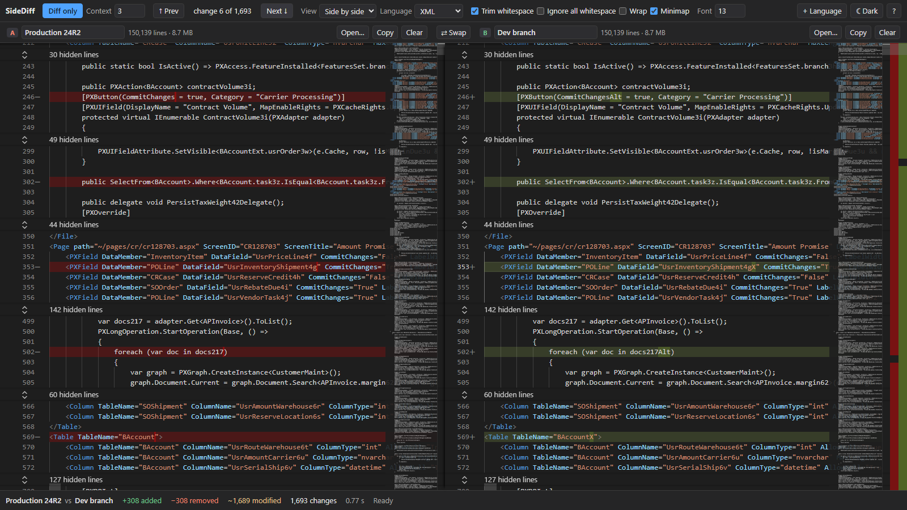

# SideDiff

SideDiff is a local, no-backend web app for comparing two very large text blobs side by side. It is built for exported Acumatica customization projects: a single `project.xml` of tens of MB (up to about 150,000 lines per side) whose elements carry C# source in CDATA, very long attribute lines and base64 payloads. Paste or load version A and version B, label them, and see only what changed.



Everything runs in the browser. There is no server, no account, no telemetry. The only network request the app can ever make is the optional download of a syntax-highlighting language pack (see [Adding a language pack](#adding-a-language-pack)).

## Features

- Side-by-side diff (or inline) with line-level and intra-line character highlighting, synchronized scrolling, line numbers and an overview ruler.
- **Diff only**: collapses unchanged regions to N context lines (0 to 20, default 3). Click a "... 1,240 unchanged lines" separator to expand it in place. It never changes the text; toggling it off restores the full view.
- Next/previous change with "change N of M".
- Stats bar: added, removed, modified, total changes, with both pane labels.
- Options: ignore leading/trailing whitespace (default on), ignore all whitespace, word wrap, minimap, font size.
- Languages: C#, XML, Plain Text, auto-detected on paste (XML if the first non-blank character is `<`, C# if the text starts with `using` or `namespace`). Override with the picker.
- Dark theme by default, light theme toggle. Settings (labels, language, theme, options, context lines, font size) persist in `localStorage`. Pane text is not persisted.
- Swap A/B, clear, copy, load a file (picker or drag-and-drop; read locally as text).
- **Acumatica project explorer**: load two `project.xml` exports and browse every item (code, screens, DACs, tables, SQL, site map, …, plus **Other**), see what one side is missing or changed, and open any item as its own diff. `Ctrl+P` jumps to an item by name. See [Project explorer](#project-explorer-acumatica-projectxml).
- `Ctrl+Z` / `Ctrl+Y` also undo paste-replace, Clear, file load and Swap.
- Degrades gracefully above 400,000 lines or 40 MB per side: warns, turns off intra-line highlighting and keeps going.

## Setup (Windows)

Requirements: Node.js 22 or newer and pnpm 12 (`packageManager` is pinned in `package.json`).

pnpm comes through corepack. On Windows, `corepack enable` fails with a permission error when Node is installed in `C:\Program Files\nodejs`. Put the shim in a folder you own that is already on `PATH` instead (decision D1):

```powershell
corepack enable --install-directory "$env:APPDATA\npm"
```

Then:

```powershell
pnpm install
pnpm dev        # http://localhost:5317 (port 5173 is avoided; the port is strict)
```

Other commands:

| Command | What it does |
|---|---|
| `pnpm build` | Type-checks, then writes the production site to `dist/` |
| `pnpm preview` | Serves `dist/` with Vite's preview server |
| `pnpm check` | `tsc` + ESLint + Vitest |
| `pnpm e2e` | Playwright end-to-end tests against `pnpm dev` |
| `pnpm fixtures` | Generates the seeded Acumatica-shaped test pairs into `fixtures/` (gitignored; run once before `pnpm e2e` / `pnpm bench`) |
| `pnpm bench` | Runs the performance gate in headless Chromium and prints pass/fail |

### Serving `dist/`

`dist/` is plain static files with relative asset paths (`base: './'`), so any static server works:

```powershell
pnpm build
npx serve dist        # or: python -m http.server -d dist 8080
```

It also works from a sub-folder of a web server. Monaco's worker is loaded from `dist/assets` as a same-origin file; browsers do not support module workers from `file://`, so open it through a server rather than double-clicking `index.html`.

## Usage

1. Paste into pane A and pane B, or drop a file onto a pane, or use the file button. Language is detected on paste.
2. Edit the labels above the panes (for example "prod 24.200" and "dev"). They show in the stats bar too.
3. Read the stats bar, then press **Diff only** (`Alt+H`) to hide everything that did not change. Adjust context lines in the toolbar.
4. Step through changes with `F7` / `Shift+F7` (or `Alt+Down` / `Alt+Up`).
5. Toggle whitespace options, wrap, inline view, theme and font size as needed.

Shortcuts are listed in [docs/SHORTCUTS.md](docs/SHORTCUTS.md) and in the app under `?`.

## Project explorer (Acumatica `project.xml`)

When either side is an Acumatica customization export (the root element is `<Customization>`), SideDiff indexes it in a background worker and shows a **project explorer** drawer on the left. Nothing extra appears for other text. Everything is local; nothing is uploaded.

**What it shows.** Every direct child of `<Customization>` is one item, grouped as Code (graph extensions, new graphs, DAC customizations, code files), Screens (pages and screen customizations, editor metadata), Tables, SQL, Reports, Generic inquiries, Site map, Integration (endpoints, scenarios, webhooks, business events) and Files. Anything unrecognized is listed under **Other**, so nothing is hidden. Items are matched between the two sides by identity (class name, screen id, table name and so on), not by position, so a moved element is not a change.

**Statuses.** Each row has a glyph as well as a colour, so status never depends on colour alone:

| Glyph | Meaning |
|---|---|
| `~` | modified |
| `≈` | whitespace only (equal after trimming each line) |
| `−` | only in A |
| `+` | only in B |
| `=` | same (dimmed) |

The drawer defaults to the **Changed** chip (everything except same); **All**, **Only A** and **Only B** show the rest. The filter box does fuzzy matching on name and detail, groups collapse, and the header warns when the two `product-version` values differ. Width, open state and filter persist.

**Item views.** Click a row (or press `Enter`) to diff just that item. A breadcrumb bar replaces the whole-project view: `← Project` (also `Alt+Left` or `Esc`), the group and item name, a **Code | XML** switch, **Show in project**, **Related**, and `‹ ›` for the previous/next item in the current filter. The Code view shows the item's C# (or the decoded page source, field list or pretty-printed JSON) with the language's highlighting; XML shows the element exactly as exported. Diff only, change navigation and the whitespace options work in an item view. An item missing on one side shows "Not in <label>" next to the other side's content. Item views are read-only; `Back` returns to the project with the explorer scroll position intact.

**Related** lists the other items with the same screen id: the page, its `.aspx`/`.cs` files, Modern UI files, the site map entry and editor fields, so one screen's pieces are one click apart.

**Files are references.** `File` and `PerTenantFile` elements in a real export do not contain the file contents: those live in the package zip, not in `project.xml`. SideDiff therefore shows them as references (path, and the XML of the element) and compares the element. It can only show their code when an export embeds a `Content` section.

**Quick open.** `Ctrl+P` fuzzy-searches every item regardless of the filter, even with the drawer closed.

**Undo for whole-text changes.** `Ctrl+Z` / `Ctrl+Y` undo and redo paste-replace, Clear, file load and drop, and Swap (one step for both sides). Typing still uses the editor's own undo first. The last 10 replacements (up to 300 MB of text) are kept, and a toast says what was undone.

## Adding a language pack

Bundled languages (`csharp`, `xml`, `plaintext`) need no network. Every other language is a *data-only* TextMate grammar (`.tmLanguage.json`) listed in `languages/manifest.json`. The app never downloads or runs JavaScript: grammars are tokenized by `vscode-textmate` with the `vscode-oniguruma` WASM that ships with the app (decision D5).

**Installing a listed pack (users):** click **+ Language**, then **Install** next to SQL or JSON. The pack is fetched from its pinned jsDelivr URL, checked, cached in IndexedDB and works offline from then on. Pick it in the **Language** menu.

**Adding a new pack to the allowlist (developers):**

1. Pick a grammar from a public MIT repository at an exact tag or commit, for example `https://cdn.jsdelivr.net/gh/microsoft/vscode@1.140.0/extensions/<lang>/syntaxes/<lang>.tmLanguage.json`. Branches and `@latest` are rejected.
2. Download the file and compute its SHA-256 over the raw bytes (`certutil -hashfile <file> SHA256`, or `sha256sum`).
3. Add an entry to `languages/manifest.json`:

   ```json
   {
     "id": "sql",
     "displayName": "SQL",
     "format": "tmlanguage-json",
     "license": "MIT",
     "url": "https://cdn.jsdelivr.net/gh/microsoft/vscode@1.140.0/extensions/sql/syntaxes/sql.tmLanguage.json",
     "sha256": "<64 hex characters>"
   }
   ```

   Rules enforced in code: the id is not a bundled id, `license` is `MIT`, the URL is `https://cdn.jsdelivr.net/gh/<owner>/<repo>@<semver tag or 40-char sha>/....json`, the hash is 64 hex characters.
4. Rebuild. The manifest is compiled into the bundle, so the allowlist is fixed at build time and the new pack shows up in the **+ Language** dialog.

Install pipeline: fetch (no credentials, no redirects, 30 s timeout) -> under 2 MB by `Content-Length` and by streamed byte count -> UTF-8 -> `JSON.parse` -> TextMate schema check -> SHA-256 equals the manifest value -> compile the grammar (bad regexes fail here) -> cache under `id@sha256` in IndexedDB -> register. Any failure shows a message and leaves the registry unchanged. Cached packs are re-verified on every load. There is no URL field, and the page CSP allows `connect-src` to `https://cdn.jsdelivr.net` only. The CSP also carries `'wasm-unsafe-eval'` (WebAssembly compilation only, not JS `eval`) for the oniguruma WASM.

## Engine decision

SideDiff uses Monaco Editor's `DiffEditor` (`monaco-editor` 0.57, pinned). It computes the diff in a web worker, has a built-in `hideUnchangedRegions` (the "diff only" feature), intra-line highlighting, side-by-side and inline modes, change navigation and `vs`/`vs-dark` themes, and ships Monarch tokenizers for C# and XML. Only the editor API plus the C# and XML registrations are imported (never the `monaco-editor` barrel), which keeps the bundle to those two language chunks.

The fallback, if Monaco had missed the performance gate, was CodeMirror 6 with `@codemirror/merge`. Outcome: Monaco passes every gate with a wide margin, so the fallback was not needed. The engine owns Monaco's diff provider (D6), implements "ignore all whitespace" with hidden whitespace-stripped shadow models so the visible text never changes (D7), and uses a 10 s diff budget (30 s when degraded), after which Monaco returns an approximate result and the stats bar says so (D8). Diffs run Monaco's own diff algorithm in a dedicated worker that the engine restarts whenever newer text or options arrive, so a stale run never delays the current one (D11). Lines over 1,000 characters (such as an exported page's encoded source) are compared as whole lines without character-level refinement, which keeps real project exports fast (D14).

## Performance gate

Measured by `pnpm bench` in headless Chromium on the 150k-line `large` pair (8.7 MB), loaded through the real file inputs. Run recorded in `bench-results/` on 2026-10-15; all PASS.

| Check | Limit | Measured |
|---|---|---|
| One 150k-line side to first render | < 2 s | 139 ms (A), 138 ms (B) |
| Diff ready, both sides | target < 5 s, hard < 10 s | 0.84 s |
| Longest main-thread block during diff | <= 200 ms | 50 ms |
| Toggle "diff only" on / off | < 1 s | 399 / 108 ms |
| Worst frame in a 5 s scripted scroll | <= 100 ms | 17 ms |
| Tab memory after diff | < 2 GB | 543 MB renderer, 66 MB JS heap |
| `stress` pair (500k lines) | no crash, warning shown, finishes or reports within 60 s | done in 3.1 s, degraded warning shown |
| Initial JS, gzipped | < 3 MB (warning only) | 0.80 MB; lazy chunks: csharp, xml only |
| Project explorer ready after load (large pair, 1,873 items) | < 1.5 s | 876 ms |
| Longest main-thread task while indexing | < 50 ms | 0 ms |
| Full diff of the 1 MB project pair (20k-char changed lines) | < 1 s, exact | 216 ms |

Two unrelated 150k-line files (every line differs) hit the diff budget and return an approximate result after about 10 s.

## Project docs

- [docs/DECISIONS.md](docs/DECISIONS.md): every deviation and choice (D1-D15): no single-file build (D10), cancellable diff worker (D11), explorer design (D12), whole-text undo (D13), long-line diffing (D14)
- [docs/INTERFACES.md](docs/INTERFACES.md): the contracts between the editor, UI and language layers
- [docs/STATUS.md](docs/STATUS.md): per-area status and measured numbers
- [docs/REVIEW.md](docs/REVIEW.md): review findings

## Privacy

No telemetry, no analytics, no upload. Files you load are read locally with the File API. Pane contents are never written to `localStorage`.
